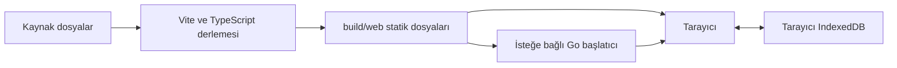

# 1. Bir yazılımı nasıl tanırız?

Bir oyuncak arabayı anlamak için önce parçalarına bakarsın: tekerlek, gövde, motor. Yazılımda da aynı yöntem işe yarar. “Hangi dosyada hangi satır var?” sorusundan önce “Kullanıcı ne yapıyor, bu işi hangi parça üstleniyor?” sorusunu sor.

## 1.1 CADinvent hangi işi yapıyor?

Kullanıcı bir veya birkaç STL, OBJ ya da PLY dosyası seçer. Uygulama bunları üçgenlerden oluşan 3B yüzeyler olarak okur, küçük resim üretir, kart halinde gösterir. Kullanıcı kartları kategorilere taşır, arar, favoriler ve büyük 3B pencerede inceler. Çalışma alanı ZIP olarak kaydedilebilir. Bu bir **mesh görüntüleyici ve düzenleyicidir**; katı model tasarlama veya STEP/IGES açma aracı değildir.

## 1.2 Projenin çalışmasını en dıştan izle

**Kaynak dosya** senin düzenlediğin metindir. **Derleme**, kaynakları tarayıcının çalıştıracağı JS/CSS dosyalarına dönüştürür. **IndexedDB**, tarayıcının kendi veri dolabıdır. Tarayıcıdaki model kopyaları proje klasörüne otomatik yazılmaz. **Git**, kaynak dosya değişikliklerini takip eder; IndexedDB içeriğini takip etmez.

Geliştirirken `pnpm dev` Vite geliştirme sunucusunu `127.0.0.1:5173` üzerinde açar. Üretim derlemesinde `pnpm build`, dosyaları [vite.config.ts](../vite.config.ts) ayarına göre `build/web/` içine koyar. Taşınabilir uygulama için Go başlatıcısı bu statik dosyaları gömer ve varsayılan olarak `127.0.0.1:47831` üzerinde sunar. İkisi farklı adres olduğundan tarayıcı onları ayrı veri alanları olarak görür.

## 1.3 Klasörleri tanı

| Yol | Görev | Normalde sen düzenler misin? |
| --- | --- | --- |
| [src/](../src) | React ekranı, veri tipleri, model ve ZIP mantığı | Evet |
| [src/components/](../src/components) | Tekrar kullanılabilir ekran parçaları | Evet |
| [src/hooks/](../src/hooks) | React çalışma alanı durumu ve kaydetme akışı | Gerektiğinde |
| [src/lib/](../src/lib) | Kategori, ayrıştırıcı, depolama, yedek ve render işlevleri | Gerektiğinde |
| [portable/](../portable) | Go ile küçük yerel başlatıcı | Başlatıcı davranışı değişirse |
| [scripts/](../scripts) | Derleme ve paketleme yardımcıları | Derleme akışı değişirse |
| [.github/workflows/](../.github/workflows) | GitHub Actions otomasyonu | Yayın akışı değişirse |
| [tests/fixtures/](../tests/fixtures) | Testlerde kullanılan küçük örnek model dosyaları | Yeni test eklerken |
| [docs/](../docs) ve [rehberler/](.) | Kullanım ve öğrenme belgeleri | Evet |
| `build/` | Üretilmiş web, başlatıcı, önbellek ve paketler | Hayır, yeniden üret |
| `node_modules/` | pnpm'in kurduğu bağımlılıklar | Hayır |
| `.git/` | Yerel Git geçmişi ve ayarları | Elle değiştirme |

`build/` ve `node_modules/` klasörlerinin [`.gitignore`](../.gitignore) içinde olması, Git'in bunları kaynak depo içeriğine eklememesini sağlar. `.gitignore` daha önce takip edilmiş bir dosyayı geçmişten çıkarmaz; yalnızca yeni izlemeyi etkiler.

## 1.4 Kök dosyalar ne anlatır?

| Dosya | Okurken arayacağın cevap |
| --- | --- |
| [package.json](../package.json) | Hangi JavaScript paketleri kullanılıyor? `pnpm dev`, `test`, `build` ne çalıştırıyor? |
| [pnpm-lock.yaml](../pnpm-lock.yaml) | Bağımlılıkların kesin sürüm çözümü ne? Tekrar üretilebilir kurulum için Git'te kalır. |
| [index.html](../index.html) | Tarayıcının açtığı HTML giriş sayfası nerede? |
| [vite.config.ts](../vite.config.ts) | Geliştirme portu ve derleme çıktı klasörü ne? |
| [tsconfig.json](../tsconfig.json) | TypeScript hangi katı denetimleri uyguluyor? |
| [pnpm-workspace.yaml](../pnpm-workspace.yaml) | pnpm'in derleme paketi ayarı ne? |
| [.editorconfig](../.editorconfig) ve [.gitattributes](../.gitattributes) | Satır sonu ve dosya düzeni nasıl tutuluyor? |
| [.vscode/tasks.json](../.vscode/tasks.json) | VSCodium görev menüsünde hangi komutlar var? |
| [.vscode/settings.json](../.vscode/settings.json) | Explorer'da hangi üretilmiş klasörler gizleniyor? |

## 1.5 Teknoloji yığını, sade dille

- **React**: Ekranı, değişen veriye göre tekrar çizer. “Seçili çalışma alanı değiştiyse görünen kartlar da değişsin” işine yarar.
- **TypeScript**: `Part`, `Category` gibi veri biçimlerini tanımlar; yanlış türde veriyi geliştirme sırasında yakalamaya çalışır.
- **Vite**: Geliştirme sunucusu ve üretim derlemesi.
- **Three.js**: Üçgenlerden 3B sahne ve küçük resim üretir.
- **Lucide**: Düğme ikonları.
- **idb / IndexedDB**: Tarayıcı içindeki kalıcı çalışma alanı ve dosya kopyaları.
- **fflate**: ZIP oluşturma ve açma.
- **Vitest**: Otomatik testler.
- **Go standart kütüphanesi**: İsteğe bağlı tek dosyalı yerel başlatıcı. Electron veya gömülü Chromium yok.

Paketlerin gerçek listesini [package.json](../package.json) içinde görebilirsin. İnternette yeni paket sürümü aramadan önce bu dosyadaki sürümü ve kilit dosyasını kontrol et.

## 1.6 Bir yazılımı anlamanın tekrar kullanılabilir yöntemi

1. **Kullanıcı hikâyesi seç.** Örneğin “Add models ile dosya ekliyorum.”
2. **Ekranda başlangıcı bul.** VSCodium aramasında `Add models` ara; [App.tsx](../src/App.tsx) içindeki düğme çıkar.
3. **Çağrılan işlevi izle.** `importFiles` içine gir, oradan `parseFile`, `thumbnail`, `saveFile` yollarını takip et.
4. **Verinin tipine bak.** [types.ts](../src/types.ts) içinde `Part` hangi bilgileri tutuyor?
5. **Kalıcı kaydı bul.** [storage.ts](../src/lib/storage.ts) içinde dosya ve çalışma alanı nerede saklanıyor?
6. **Testi bul.** Yakınındaki `*.test.ts` dosyaları hangi davranışı doğruluyor?
7. **Küçük bir değişiklik yap.** Sadece metni değiştirip tarayıcıda sonucu gör. Sonra `git diff` ile tam farkı oku.

Bu yöntemi her özellikte tekrarlayabilirsin. Tüm dosyaları baştan sona sırayla okumak zorunda değilsin.
