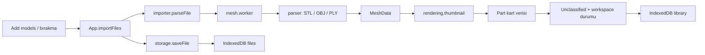

# 3. Model dosyası ve ZIP yedeği nasıl ilerler?

Bu bölümde bir model dosyasını kargo gibi takip edeceğiz. Kullanıcı dosyayı seçer, uygulama paketi kontrol eder, içinden 3B şekli çıkarır, vitrinde küçük resmini gösterir ve asıl paketin kopyasını tarayıcı deposuna koyar. ZIP yedeği bu kopyaları bir araya getirir.

## 3.1 İki farklı “Import” var

**Add models**, yeni STL/OBJ/PLY ağ dosyalarını etkin çalışma alanına ekler. Workspace sekmesindeki düğmeden veya bırakma alanından başlatılır. Yeni parça önce `Unclassified` içine gider.

Üst çubuktaki **Import → Import Workspace** yalnızca CADinvent'in oluşturduğu tek `.zip` yedeğini kabul eder. Bu, içindeki kategoriler ve modellerle **yeni** bir çalışma alanı kurar. Tek başına STL dosyasını bu menüye vermek doğru değildir. Bu ayrımı [App.tsx](../src/App.tsx) içindeki iki gizli `input type="file"` ve iki ayrı işlevde görebilirsin.

## 3.2 Yeni model ekleme adımları



1. [App.tsx](../src/App.tsx) içindeki `importFiles` dosyaları sırayla işler; durum mesajını günceller. Bir dosya hata verirse diğerleri denenmeye devam eder ve dosya adına bağlı hata gösterilir.
2. [importer.ts](../src/lib/importer.ts) uzantıyı ve 80 MiB dosya sınırını kontrol eder. Dosyayı `ArrayBuffer` olarak okuyup [mesh.worker.ts](../src/lib/mesh.worker.ts) işçisine aktarır. Bu aktarımda mümkün olduğunca `transferable` tamponlar kullanılır. Bir dosyanın ayrıştırması için 30 saniye sınırı vardır; işçi bitince sonlandırılır.
3. [parser.ts](../src/lib/parser.ts) Three.js yükleyicileriyle STL, OBJ veya PLY okur. OBJ içindeki geometriler tek işlenebilir ağ verisine getirilir. Boş/geçersiz değerler reddedilir; 2 milyon üçgen sınırı uygulanır. Boyutlar merkezleme öncesi hesaplanır, dolayısıyla model ekranda ortalanırken ölçü bilgisi korunur. Fiziksel birim bilinmez; STL/OBJ/PLY her zaman güvenilir mm/inç bilgisi taşımaz.
4. [rendering.ts](../src/lib/rendering.ts) `MeshData` üzerinden 400×400 küçük 3B görüntü üretir. Kartta bu WebP görüntü gösterilir; her kart için sürekli çalışan ayrı WebGL sahnesi kurulmaz.
5. [storage.ts](../src/lib/storage.ts) özgün `File` nesnesini `files` deposuna parça kimliğiyle yazar. [types.ts](../src/types.ts) biçimindeki `Part` kaydı ise ad, format, küçük resim, boyut ve kategori bilgisini taşır. [useWorkspaces.ts](../src/hooks/useWorkspaces.ts) bunu `library` deposundaki çalışma alanı durumuna kaydeder.

Tarayıcıda 10 model kartı görmen, 10 adet sürekli 3B motor çalıştığı anlamına gelmez. Kartlar hazırlanmış resim kullanır. Bir karta basınca [Inspector.tsx](../src/components/Inspector.tsx) özgün dosyayı tekrar okuyup etkileşimli sahne açar; kapanışta geometri ve renderer kaynaklarını serbest bırakır.

## 3.3 Neden worker ve sırayla işlem?

Çok büyük bir modelin üçgenlerini okumak zaman alabilir. Bunu doğrudan ekranı çizen iş parçacığında yapmak arayüzü dondurabilir. `mesh.worker.ts` ve `archive.worker.ts` ağır işleri ayrı iş parçacığına taşır. Sırayla import, aynı anda çok sayıda büyük geometriyi bellekte tutma olasılığını düşürür. Her dosyadan sonra kısa bir olay döngüsü aralığı bırakılır ki arayüz durum mesajını güncelleyebilsin.

Bu bir **tam akışlı, sabit bellekli** mimari değildir. Dosya okuma, geometri işleme ve ZIP açma sırasında ek bellek gerekir. Büyük kütüphanelerde bütün küçük resim/metadata React durumunda kalır; raflar sanallaştırılmamıştır. Cihazın GPU'su, RAM'i ve tarayıcı kota sınırı hâlâ önemlidir.

## 3.4 Tarayıcı deposu nasıl düzenlenmiş?

[storage.ts](../src/lib/storage.ts) `cadinvent` adlı IndexedDB veritabanını, `library` ve `files` adlı iki depoyla açar. `library` içindeki `workspaces-v1` anahtarı çalışma alanlarının listesini ve etkin alanı tutar. `files` ise modelin özgün kopyasını parça kimliğiyle saklar. Eski `current` kütüphane kaydı varsa açılışta yeni çalışma alanı biçimine taşınır. Eksik `Unclassified` kategorisi de yüklemede onarılır.

Bu veriler belirli **tarayıcı + profil + köken** üçlüsüne bağlıdır. `http://127.0.0.1:5173`, `http://127.0.0.1:47831` ve gelecekteki bir HTTPS site adresi ayrı depolar kullanır. Firefox'ta eklediğin parçalar Chrome'da otomatik görünmez. Gizli pencere, site verisini temizleme veya tarayıcının depoyu boşaltması verileri silebilir. Önemli çalışma alanını Export Workspace ile ZIP olarak ayrıca sakla.

## 3.5 ZIP'in tam yapısı

Bir çalışma alanı dışa aktarıldığında **tek** ZIP indirilir:

```text
ornek-calisma-alani.zip
├── workspace.json
└── models/
    ├── 0.stl
    ├── 1.obj
    └── 2.ply
```

`workspace.json` ZIP'in kökündedir. `models/` içindeki dosyalar özgün model baytlarıdır; `0.stl` gibi adlar ZIP içindeki teknik yollardır. Kullanıcının gördüğü dosya adı manifestteki `name` alanında saklanır. Bu dosyayı elle değiştirirsen hem yapı hem SHA-256 denetimi tutmalı; yeni başlayan biri için en güvenli yöntem uygulamanın ürettiği ZIP'i olduğu gibi kullanmaktır.

Örnek şema, değerler temsili:

```json
{
  "kind": "cadinvent-workspace",
  "schemaVersion": 1,
  "backupId": "bir-uuid",
  "exportedAt": "2026-11-21T12:00:00.000Z",
  "workspace": {
    "name": "Atolye",
    "createdAt": "2026-11-20T12:00:00.000Z"
  },
  "categories": [
    {
      "id": "unclassified",
      "name": "Unclassified",
      "color": "#..."
    }
  ],
  "parts": [
    {
      "id": "bir-baska-uuid",
      "name": "bracket.stl",
      "categoryId": "unclassified",
      "format": "STL",
      "bytes": 12345,
      "sha256": "64-karakterlik-onaltilik-ozet",
      "path": "models/0.stl",
      "createdAt": "2026-11-21T12:00:00.000Z",
      "favorite": false
    }
  ]
}
```

Yukarıdaki `#...` ve SHA-256 metni gerçek doğrulayıcıdan geçmez; yalnızca alanların anlamını göstermek içindir. Geçerli örnek için uygulamadan boş ya da küçük bir çalışma alanını Export Workspace ile dışarı al. Kesin şema [archive.ts](../src/lib/archive.ts) içindeki `WorkspaceManifest` ve `validateManifest` kodudur.

## 3.6 ZIP dışa aktarma zinciri

[App.tsx](../src/App.tsx) → [backup.ts](../src/lib/backup.ts) `createBackup` → [storage.ts](../src/lib/storage.ts) `loadFile` → [archive.ts](../src/lib/archive.ts) checksum/manifest → [archive.worker.ts](../src/lib/archive.worker.ts) ZIP → [export.ts](../src/lib/export.ts) indirme.

Her model için SHA-256 özeti hesaplanır. Manifestte kategori ayarları, parçaların kategori bağlantıları, adları ve favori bilgileri vardır. Eski sürümden kalmış `demo` parçası varsa [sampleExport.ts](../src/lib/sampleExport.ts) onu STL'ye dönüştürerek yedeğe katabilir. Normal kullanıcı dosyaları özgün hâliyle alınır. İşlem sırasında gereken kaynak dosya IndexedDB'de yoksa yedek oluşturma hata verir; eksik modelle sessizce yedek çıkarmaz.

## 3.7 ZIP içe aktarma zinciri

**Import → Import Workspace** → [backup.ts](../src/lib/backup.ts) `readBackup` → worker ile ZIP açma → [archive.ts](../src/lib/archive.ts) biçim, yol, boyut, kategori bağlantısı ve checksum kontrolü → her modeli yeniden ayrıştırma/küçük resim üretme → [useWorkspaces.ts](../src/hooks/useWorkspaces.ts) `restoreWorkspace` → [storage.ts](../src/lib/storage.ts) `saveRestoredWorkspace`.

Geri yükleme mevcut çalışma alanlarının üzerine yazmaz; yeni bir çalışma alanı oluşturur. Ad çakışırsa ada sıra eki eklenir. Parça kimlikleri yeni oluşturulur, dosyalar bu yeni kimliklerle saklanır. ZIP doğrulaması ve model ayrıştırması tamamlandıktan sonra dosyalar ile çalışma alanı verisi tek IndexedDB işleminde yazılır. Bu işlem başarısız olursa mevcut çalışma alanları yerinde kalır.

Doğrulama, `workspace.json` dışındaki beklenmeyen yolları, yinelenen kayıtları, yanlış uzantıyı, bozuk SHA-256'yı ve manifestte olmayan dosyaları reddeder. Düz `../` gibi ZIP yol kaçışları kabul edilmez. Sınırlar: model başına 80 MiB, kaynak modeller toplamı 256 MiB, JSON 8 MiB, en fazla 5.000 parça ve 1.000 kategori. ZIP arşivinin kendisi ve açılmış boyut için de sınırlar vardır. Bunlar [archive.ts](../src/lib/archive.ts) sabitlerinde görülebilir.

## 3.8 Sık karışan üç şey

| Şey | Nerede? | Amacı |
| --- | --- | --- |
| Kaynak modelin bilgisayardaki aslı | Kullanıcının seçtiği klasörde | Orijinal CAD dosyası; uygulama bunu silmez |
| Modelin tarayıcı kopyası | IndexedDB `files` | Kartı yeniden incelemek ve ZIP yedeklemek |
| `build/web/` | Proje klasöründe | Uygulamanın derlenmiş JS/CSS/HTML çıktısı; kullanıcı model kütüphanesi değil |

Kategori silince parça tarayıcıda kalır ve `Unclassified` içine taşınır. Parçayı kütüphaneden kaldırmak veya çalışma alanını silmek tarayıcı kopyasını kaldırabilir; bilgisayardaki özgün dosyayı silmez. ZIP yedeği, tarayıcı deposu kaybolduğunda çalışma alanını geri getirmek için ayrı tutulmalıdır.
